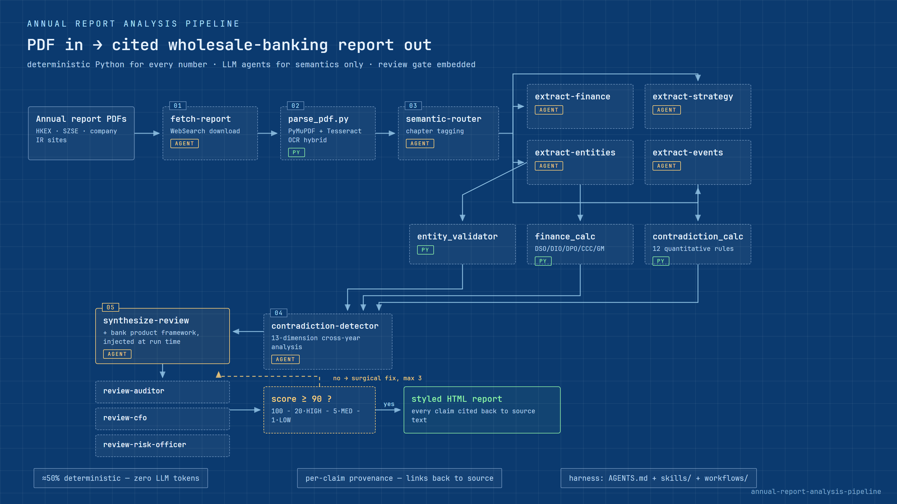
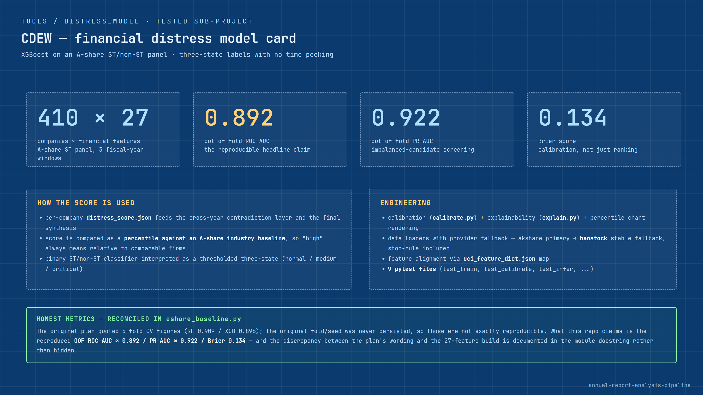

# Annual Report Analysis Pipeline

A multi-agent pipeline that turns raw listed-company annual reports (PDF) into a
cited, cross-checked **wholesale-banking credit & opportunity report** — built to run
inside an agent harness (the `AGENTS.md` + `skills/<name>/SKILL.md` + workflow pattern used
by Codex / Claude Code style tools).

Design principle: **the LLM never does arithmetic, and every claim stays traceable to the
source document.** Financial metrics, ratios and cross-year flags are computed by Python;
LLM agents only do semantic work (routing, extraction, contradiction analysis, synthesis),
each behind a versioned runbook and a JSON schema.

## Pipeline




- **~50% of the pipeline is deterministic Python** (parse, chapter detection, finance calc,
  contradiction calc) — zero LLM tokens, fully reproducible.
- **Review is part of the pipeline, not an afterthought**: three blinded reviewer agents score
  the report 0–100 (`score = 100 − 20·HIGH − 5·MED − 1·LOW`); below 90 triggers a fix loop.
  Fixes are **surgical edits** to the delivered HTML, not full re-synthesis — full
  re-synthesis repeatedly scored worse (3 rounds → 75; one targeted 9-edit pass → pass).
- **Every conclusion links back to the report text** it came from (per-claim provenance).

## The distress model (CDEW)

`tools/distress_model/` is a complete, tested sub-project: an XGBoost financial-distress
model trained on an A-share ST/non-ST panel (410 companies × 27 financial features,
three-state labelling with no time peeking), **out-of-fold ROC-AUC 0.89** / PR-AUC 0.92 /
Brier 0.134:



With:

- per-company percentile comparison against industry baselines,
- calibration, SHAP-style explainability, and percentile chart rendering,
- pytest suite (`tools/distress_model/test_*.py`).

## Repository layout

```
├── AGENTS.md              # harness operating manual (paths, boundaries, quality gate)
├── skills/                # 13 pipeline nodes as skills/<name>/SKILL.md
│                          # (frontmatter: model + temperature; body: system prompt + IO contract)
├── workflows/             # pipeline orchestrators (single-year, multi-year)
├── tools/                 # deterministic Python tools + distress_model sub-project
├── reference/
│   ├── product-framework/ # wholesale-banking coverage & product framework (generic skeleton)
│   │                      # + runtime knowledge-injection mechanism
│   └── templates/         # report HTML rendering
└── docs/design-notes.md   # design-decision log with precedents
```

## Running

The pipeline is driven through an agent harness that reads `AGENTS.md`:

```
/workflows/annual-report-pipeline.js <Company> <Year>
/workflows/annual-report-pipeline-multi-year.js <Company> <Y1> <Y2> <Y3>
```

Deterministic pre/post-processing runs standalone (no LLM needed):

```
python tools/run_multi_year.py <Company> <Y1> <Y2> <Y3>
```

Install Python dependencies with `pip install -r requirements.txt` (PyMuPDF, sklearn, xgboost,
...). LLM access is configured via a `.env` file with an OpenAI-compatible API key
(`OPENROUTER_API_KEY`; see the per-skill frontmatter for each node's model).

## Design notes

- **Agent harness first, Dify first**: the pipeline started as a Dify workflow prototype and
  was migrated to an agent harness; the synthesizer is bank-agnostic because the bank's
  product framework is injected at run time rather than hard-coded
  (`reference/product-framework/`).
- **Benchmark data not included**: the industry-benchmark layer consumes an
  `industry_benchmarks.json` compiled from public Damodaran datasets; the data file is not
  shipped and the pipeline skips benchmarking gracefully without it.
- **Redactions**: the client-engagement context and the bank-specific instance of the product
  framework are excluded from this public copy; the generic skeleton and the injection
  mechanism are included.
- **Quality program**: development was driven by a staged quality plan with explicit
  acceptance criteria and independent build reviews — the honest metric reconciliation this
  produced is documented in `tools/distress_model/ashare_baseline.py`.
